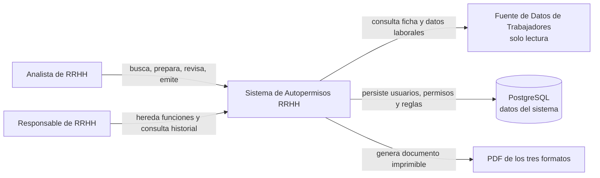
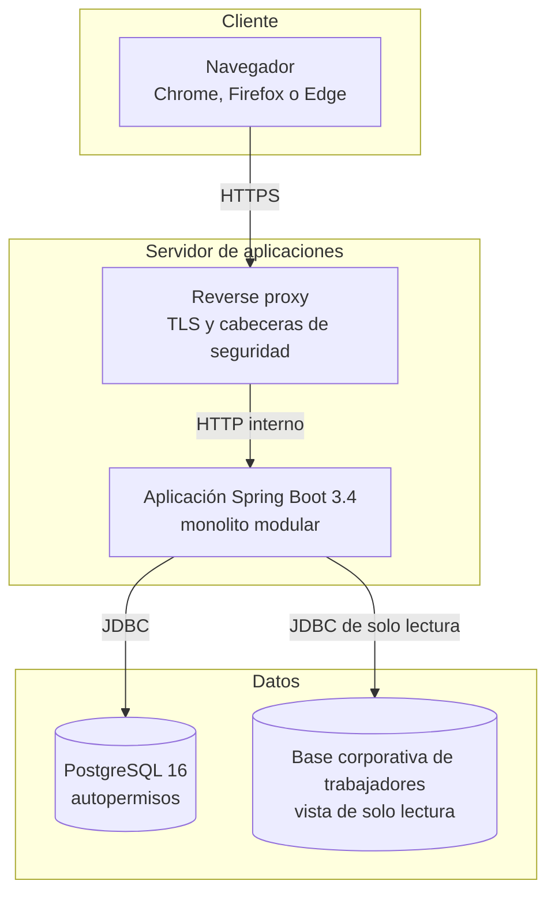
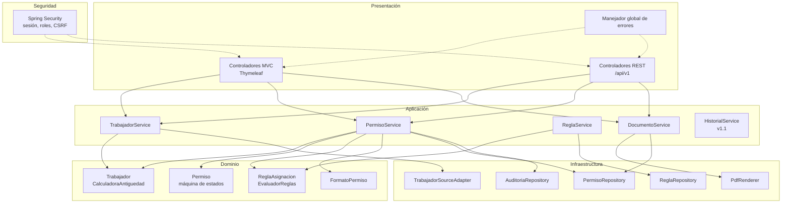
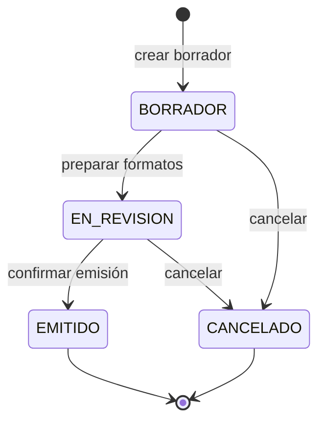
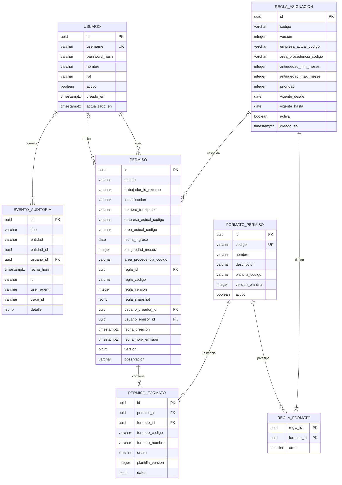
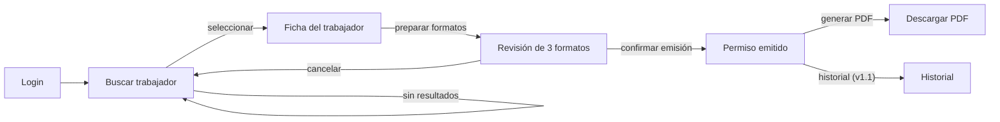
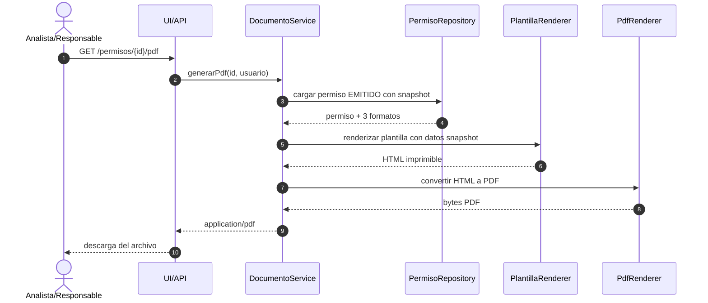
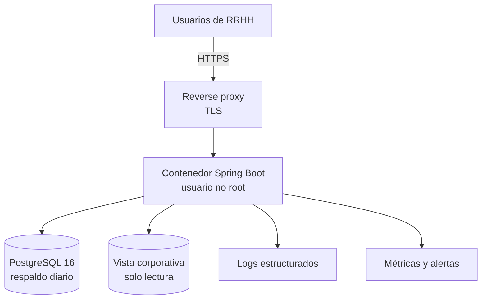

# Arquitectura del Sistema de Autopermisos RRHH

| Campo | Valor |
|---|---|
| Proyecto | Sistema de Autopermisos RRHH |
| Documento | Arquitectura de la solución |
| Versión | 1.0 |
| Fecha | 2026-11-17 |
| Estado | Propuesta para validación con RRHH y el docente-cliente |
| Autores | Dennison Chalacan, Jeffrey Manobanda, Fernando Tipan |
| Repositorio | <https://github.com/DennisonCc/autopermisos-rrhh> |
| Documentos base | [Requisitos](../02-requisitos/README.md), [Casos de uso](<Casos de uso del proyecto.pdf>), [Planificación](../01-planificacion/README.md) |

---

## Contenido

1. [Resumen ejecutivo](#1-resumen-ejecutivo)
2. [Alcance y supuestos](#2-alcance-y-supuestos)
3. [Impulsores de la arquitectura](#3-impulsores-de-la-arquitectura)
4. [Decisiones de arquitectura](#4-decisiones-de-arquitectura)
5. [Estilo arquitectónico](#5-estilo-arquitectónico)
6. [Vista de contexto](#6-vista-de-contexto)
7. [Vista de contenedores](#7-vista-de-contenedores)
8. [Vista de componentes](#8-vista-de-componentes)
9. [Organización del código](#9-organización-del-código)
10. [Modelo de dominio](#10-modelo-de-dominio)
11. [Arquitectura del motor de reglas](#11-arquitectura-del-motor-de-reglas)
12. [Arquitectura de datos](#12-arquitectura-de-datos)
13. [Diseño de la API REST](#13-diseño-de-la-api-rest)
14. [Arquitectura de la interfaz web](#14-arquitectura-de-la-interfaz-web)
15. [Arquitectura de seguridad](#15-arquitectura-de-seguridad)
16. [Generación de PDF](#16-generación-de-pdf)
17. [Transacciones, concurrencia e idempotencia](#17-transacciones-concurrencia-e-idempotencia)
18. [Requisitos no funcionales](#18-requisitos-no-funcionales)
19. [Despliegue y operación](#19-despliegue-y-operación)
20. [Pruebas y aseguramiento de calidad](#20-pruebas-y-aseguramiento-de-calidad)
21. [Trazabilidad requisitos → arquitectura](#21-trazabilidad-requisitos--arquitectura)
22. [Riesgos y deuda técnica](#22-riesgos-y-deuda-técnica)
23. [Evolución prevista](#23-evolución-prevista)
24. [Decisiones pendientes](#24-decisiones-pendientes)
25. [Glosario](#25-glosario)
26. [Fuentes](#26-fuentes)

---

## 1. Resumen ejecutivo

El Sistema de Autopermisos RRHH automatiza la búsqueda de trabajadores, la validación de sus datos laborales, la determinación de los tres formatos de permiso que les corresponden, la revisión y confirmación de la emisión, y la generación de un PDF listo para impresión. El problema central identificado por RRHH es la selección manual del formato incorrecto y la digitación repetitiva de datos; por eso el motor de reglas es el componente más crítico del sistema.

La arquitectura propuesta es un **monolito modular** desarrollado con **Java 21, Spring Boot 3.4, Maven y PostgreSQL 16**, empaquetado en Docker y construido mediante GitHub Actions. Se eligió un monolito modular —y no microservicios— porque el equipo es pequeño, el dominio está acotado y el plazo es de 16 semanas. La modularidad interna permite separar trabajadores, permisos, reglas, formatos y documentos sin asumir el coste operativo de varios servicios.

Principios centrales:

- **La fuente de datos de trabajadores es externa y de solo lectura.** Se accede mediante un puerto y un adaptador, no directamente desde los controladores.
- **Las reglas de negocio son datos versionados, no código disperso.** Se almacenan en PostgreSQL y se evalúan con un motor determinista y testeable.
- **Toda emisión conserva una fotografía de los datos y de la regla aplicada.** Esto permite auditar y reproducir el permiso aunque el trabajador o la regla cambien después.
- **La interfaz web es server-side con Thymeleaf**, y se expone además una API REST versionada para futuras integraciones. Ambas capas usan los mismos servicios de aplicación.
- **La seguridad se aplica por defecto**: autenticación por sesión, roles, CSRF, cookies seguras, validación de entrada y minimización de datos personales.
- **El historial de permisos se difiere a la v1.1**, pero el modelo de datos y el registro de emisión se implementan desde la v1.0 para evitar retrabajo.

---

## 2. Alcance y supuestos

### 2.1 Alcance de la versión 1.0

| Elemento | Incluido en v1.0 |
|---|---|
| CU-001 Autenticarse | Sí |
| CU-002 Buscar trabajador | Sí |
| CU-003 Consultar ficha del trabajador | Sí |
| CU-004 Preparar formatos de permiso | Sí |
| CU-005 Revisar formatos completados | Sí |
| CU-006 Confirmar emisión y registrar fecha | Sí |
| CU-007 Generar PDF de los formatos | Sí, después de confirmar la emisión |
| CU-008 Validar datos del trabajador | Sí |
| CU-009 Consultar historial de permisos | No; se implementa en v1.1 |
| CU-010 Gestionar trabajador no encontrado | Sí |
| HU9, HU1, HU2, HU3, HU4, HU5, HU6, HU7, HU8, HU10 | Sí |
| HU11 Historial de permisos | Datos persistidos en v1.0; consulta en v1.1 |

### 2.2 Fuera de alcance

- Administración de usuarios, credenciales y recuperación de contraseñas.
- Gestión de nómina, contratos, vacaciones o expedientes de RRHH.
- Modificación de los datos laborales del trabajador.
- Administración visual de las reglas de negocio.
- Almacenamiento documental externo o firma electrónica.
- Mantenimiento de infraestructura, redes o base de datos corporativa.
- Integración con sistemas de nómina o de marcación.

La administración de usuarios queda fuera del sistema, pero la v1.0 necesita usuarios para autenticar. Se resuelve con **aprovisionamiento inicial mediante migración/seed** y sin pantalla de administración. La matriz definitiva de roles debe validarse con RRHH.

### 2.3 Supuestos

1. La fuente corporativa de trabajadores expone un identificador estable y una vista de solo lectura con los campos requeridos.
2. Un trabajador pertenece a una empresa actual y tiene una fecha de ingreso original; la antigüedad se calcula desde esa fecha.
3. El área de procedencia es la anterior a la división empresarial y puede estar ausente; en ese caso el sistema bloquea la asignación.
4. Cada regla aprobada produce exactamente tres formatos.
5. La zona horaria de presentación es `America/Guayaquil`; la persistencia de marcas de tiempo es en UTC.
6. La v1.0 se despliega como una instancia de aplicación; si se requieren dos o más réplicas, se habilitará sesión compartida con Spring Session JDBC.
7. El PDF de una emisión contiene los tres formatos en un solo archivo.
8. Los roles iniciales son `ANALISTA_RRHH` y `RESPONSABLE_RRHH`; el responsable hereda las funciones del analista y accede al historial.

---

## 3. Impulsores de la arquitectura

### 3.1 Requisitos funcionales

| ID | Requisito | Implicación arquitectónica |
|---|---|---|
| RF1 | Buscar trabajador por nombre, identificación u otro identificador | Puerto de búsqueda, paginación, tolerancia a coincidencias parciales y control de latencia |
| RF2 | Mostrar empresa, área, antigüedad y área de procedencia en una vista | Modelo de lectura consolidado y cálculo de antigüedad en el dominio |
| RF3 | Determinar automáticamente los tres formatos | Motor de reglas determinista, versionado y con pruebas de cobertura |
| RF4 | Autocompletar nombre, área y fecha | Plantillas de formato y composición de datos en el dominio |
| RF5 | Presentar los formatos antes de emitir | Estado `EN_REVISION` persistido y vista de revisión |
| RF6 | Validar datos completos antes de aplicar reglas | Servicio de validación previo al motor y errores de negocio tipados |
| RF7 | Registrar fecha de emisión | Marca de tiempo UTC, usuario emisor y auditoría |
| RF8 | Generar PDF imprimible | Renderizado desde plantillas y verificación de contenido |
| RF9 | Autenticación con roles | Spring Security, sesión, BCrypt y autorización por rol |
| RF10 | Mensaje de trabajador no encontrado | Respuesta de negocio explícita, sin errores técnicos |
| HU11 | Historial de permisos | Modelo de emisión persistido desde v1.0; consulta en v1.1 |

### 3.2 Requisitos no funcionales

| ID | Categoría ISO 25010 | Meta | Decisión arquitectónica |
|---|---|---|---|
| RNF1 | Rendimiento | Búsqueda < 2 s con 5 usuarios simultáneos | Índices en la fuente, paginación, timeout de consulta y pool acotado |
| RNF2 | Seguridad | Solo personal de RRHH autenticado | Sesión, roles, CSRF, TLS, BCrypt y mínimo privilegio |
| RNF3 | Fiabilidad | 99 % en horario laboral | Health checks, reinicio automático, respaldos y monitoreo |
| RNF4 | Usabilidad | Operación sin capacitación > 30 min | Flujo guiado, mensajes claros y una sola ficha consolidada |
| RNF5 | Mantenibilidad | Cobertura ≥ 70 % en reglas | Motor aislado, pruebas parametrizadas y JaCoCo |
| RNF6 | Portabilidad | Chrome, Firefox y Edge (2 últimas versiones) | HTML/CSS/JS estándar, sin plugins ni APIs propietarias |

### 3.3 Reglas de negocio

| ID | Regla | Tratamiento |
|---|---|---|
| RN1 | Antigüedad desde la fecha de ingreso original | `CalculadoraAntiguedad` usa la fecha original y una fecha de referencia |
| RN2 | Área de procedencia obligatoria; si falta, alertar y no aplicar reglas | `ValidadorDatosTrabajador` bloquea el flujo con `DATOS_INCOMPLETOS` |
| RN3 | Tres formatos según empresa actual, antigüedad y área de procedencia | Tabla `regla_asignacion` + `regla_formato`, versionadas y validadas por RRHH |

### 3.4 Restricciones

- Java 21, Spring Boot 3.4 y Maven, según el plan de construcción.
- PostgreSQL como base de datos principal.
- GitHub, GitHub Actions y Docker para construcción y despliegue.
- Equipo de tres personas y ventanas de dos semanas.
- La fuente de trabajadores no se modifica desde este sistema.
- Las reglas exactas de asignación aún no están cerradas (D1 del documento de requisitos).
- El documento Lab2 define el proceso Scrum y el objetivo del Sprint 2 (arquitectura inicial, autenticación y base de datos), pero no prescribe un patrón arquitectónico; la elección de monolito modular se justifica en este documento.

---

## 4. Decisiones de arquitectura

| ID | Decisión | Alternativas descartadas | Razón | Consecuencia |
|---|---|---|---|---|
| ADR-01 | Monolito modular por dominios | Microservicios, monolito por capas simple | Equipo pequeño, dominio acotado, menor coste operativo | Un solo despliegue; se debe cuidar la frontera entre módulos |
| ADR-02 | Thymeleaf server-side + API REST | SPA React/Angular, solo API | Menos piezas para el equipo y una API disponible para evolución | La UI y la API comparten servicios; hay que evitar duplicar lógica |
| ADR-03 | PostgreSQL 16 + Flyway | H2 en producción, NoSQL | Integridad relacional, consultas y migraciones versionadas | Las pruebas de integración deben usar PostgreSQL real |
| ADR-04 | Puerto/adaptador para trabajadores | Acceso JDBC directo desde controladores | Desacopla la fuente externa y permite cambiar de BD a API | Hay que definir el contrato de la vista y su disponibilidad |
| ADR-05 | Reglas en base de datos, versionadas | Reglas en `if/else`, reglas en archivo | Cambios sin recompilar y trazabilidad de la versión aplicada | Se necesita una validación estricta de reglas y su carga |
| ADR-06 | Fotografía de datos y regla en la emisión | Consultar datos actuales al generar PDF | El permiso emitido debe ser reproducible y auditable | Se duplican datos controladamente en `permiso` y `permiso_formato` |
| ADR-07 | PDF embebido con plantillas HTML | Servicio externo de PDF | Menos dependencia operativa y consistencia pantalla/PDF | Se debe probar la librería y la fuente tipográfica |
| ADR-08 | Sesión con Spring Security | JWT para la UI | Simplicidad, CSRF y cookies `HttpOnly` | Si se escala horizontalmente, se requiere sesión compartida |
| ADR-09 | Historial en v1.1 con modelo listo desde v1.0 | Guardar solo el PDF | Menor deuda y consultas flexibles | La pantalla y el endpoint de historial se difieren |
| ADR-10 | Pruebas de integración con Testcontainers | Solo H2 | Evita divergencias de SQL y comportamiento | Requiere Docker en CI y en el entorno local |

---

## 5. Estilo arquitectónico

### 5.1 Vista general

Se adopta un **monolito modular con arquitectura en capas por dominio** y **puertos/adaptadores en las fronteras externas**. La regla de dependencia es:

```text
api (presentación) → application → domain
                         ↑
                   infrastructure
```

- `domain` no depende de Spring, JPA ni de la base de datos.
- `application` orquesta casos de uso y transacciones.
- `api` adapta HTTP, valida formato de entrada y traduce a DTOs.
- `infrastructure` implementa persistencia, fuente externa, PDF y auditoría.

Los módulos funcionales son: `trabajadores`, `permisos`, `reglas`, `formatos`, `documentos`, `seguridad` y `shared`. La comunicación entre módulos se hace por interfaces de aplicación; no se comparten entidades JPA entre módulos.

### 5.2 Principios

- **Fail fast:** los datos incompletos o las reglas inconsistentes se rechazan antes de emitir.
- **Determinismo:** la misma entrada y la misma versión de regla producen los mismos tres formatos.
- **Trazabilidad:** toda emisión registra usuario, fecha/hora, regla, formatos y versión de plantilla.
- **Mínimo privilegio:** cada rol accede solo a las operaciones necesarias.
- **Minimización de datos:** solo se persiste la información necesaria para emitir y auditar.
- **Configuración externa:** credenciales, URLs y perfiles se inyectan por variables de entorno.
- **Sin estado de negocio en la sesión:** la sesión solo conserva identidad y preferencias; los borradores viven en la base de datos.

---

## 6. Vista de contexto



**Actores y sistemas externos**

| Elemento | Tipo | Relación |
|---|---|---|
| Analista de RRHH | Actor primario | Búsqueda, ficha, preparación, revisión y emisión |
| Responsable de RRHH | Actor primario | Todo lo del analista + historial (v1.1) |
| Fuente de Datos de Trabajadores | Sistema externo | Consulta de solo lectura mediante vista/API |
| PostgreSQL | Almacén interno | Usuarios, reglas, permisos, formatos y auditoría |
| Generador de PDF | Componente interno | Reemplaza al servicio externo del modelo de casos de uso; se puede sustituir por un adaptador |

**Frontera:** el sistema no modifica datos laborales, no administra nómina y no gestiona la infraestructura corporativa. La generación de PDF se internaliza en v1.0 por simplicidad; si la organización exige un servicio documental corporativo, se implementa otro adaptador del puerto `DocumentoPort`.

---

## 7. Vista de contenedores



| Contenedor | Responsabilidad | Tecnología |
|---|---|---|
| Navegador | Interacción de RRHH | HTML, CSS y JavaScript estándar |
| Reverse proxy | TLS, compresión y cabeceras | Nginx o Traefik |
| Aplicación | Lógica de negocio, API, UI y PDF | Java 21 + Spring Boot 3.4 |
| PostgreSQL | Persistencia del sistema | PostgreSQL 16 |
| Fuente de trabajadores | Datos laborales | Vista o API corporativa, sin escritura |

---

## 8. Vista de componentes



### 8.1 Responsabilidades

| Componente | Responsabilidad | No debe hacer |
|---|---|---|
| `TrabajadorService` | Buscar, consultar ficha y calcular antigüedad | Aplicar reglas de formatos |
| `PermisoService` | Crear borrador, validar, revisar, confirmar y orquestar la emisión | Consultar directamente la base externa |
| `ReglaService` | Resolver la regla vigente y cargar los tres formatos | Renderizar PDF |
| `DocumentoService` | Generar el PDF desde una emisión confirmada | Cambiar el estado del permiso |
| `HistorialService` | Consultar emisiones (v1.1) | Modificar permisos |
| `TrabajadorSourceAdapter` | Traducir la vista/API externa al modelo de dominio | Exponer detalles de la BD externa |
| `PermisoRepository` | Persistir el agregado `Permiso` y sus formatos | Contener reglas de negocio |
| `PdfRenderer` | Convertir la plantilla y el snapshot en PDF | Decidir si el permiso es emitible |
| `AuditoriaRepository` | Registrar eventos relevantes | Ser la fuente de verdad del permiso |

---

## 9. Organización del código

La estructura actual del repositorio es un esqueleto por capas. La arquitectura objetivo organiza el código **por módulo de dominio**, manteniendo las capas dentro de cada módulo:

```text
src/main/java/com/autopermisos/rrhh/
├── AutopermisosRrhhApplication.java
├── shared/
│   ├── config/              # Beans, reloj, Jackson, OpenAPI
│   ├── security/            # SecurityConfig, usuarios y roles
│   ├── error/               # ApiException, ProblemDetails, handler global
│   ├── audit/               # EventoAuditoria, AuditService
│   └── time/                # Clock, ZoneId, formateadores
├── trabajadores/
│   ├── api/                 # TrabajadorController, DTOs
│   ├── application/         # BuscarTrabajador, ConsultarFicha
│   ├── domain/              # Trabajador, Antiguedad, TrabajadorSourcePort
│   └── infrastructure/      # JdbcTrabajadorAdapter, row mapper
├── permisos/
│   ├── api/                 # PermisoController, DTOs
│   ├── application/         # CrearBorrador, ConfirmarEmision
│   ├── domain/              # Permiso, EstadoPermiso, PermisoFormato
│   └── infrastructure/      # PermisoJpaRepository, mapper
├── reglas/
│   ├── application/         # AsignarFormatos
│   ├── domain/              # ReglaAsignacion, EvaluadorReglas
│   └── infrastructure/      # ReglaJpaRepository
├── formatos/
│   ├── domain/              # FormatoPermiso
│   └── infrastructure/      # FormatoJpaRepository, plantillas
├── documentos/
│   ├── application/         # GenerarPdf
│   └── infrastructure/      # ThymeleafPdfRenderer, DocumentoPort
└── historial/               # v1.1
    ├── api/
    └── application/
```

**Reglas de dependencia**

- `api` solo puede depender de `application` y de DTOs.
- `application` depende de `domain` y de puertos.
- `domain` no importa `org.springframework`, `jakarta.persistence` ni `java.sql`.
- `infrastructure` implementa puertos y depende de `domain`.
- Un módulo no accede a los repositorios de otro; usa su interfaz de aplicación.

La migración desde el esqueleto actual se hace de forma incremental, empezando por `trabajadores` y `permisos`, sin una reescritura total.

---

## 10. Modelo de dominio

### 10.1 Entidades y agregados

| Concepto | Tipo | Descripción |
|---|---|---|
| `Usuario` | Entidad | Identidad de RRHH con rol y estado |
| `Trabajador` | Modelo de lectura externo | Datos laborales obtenidos de la fuente corporativa |
| `Antiguedad` | Objeto de valor | Meses completos desde la fecha de ingreso original |
| `Permiso` | Agregado raíz | Borrador/emisión de un permiso para un trabajador |
| `PermisoFormato` | Entidad hija | Cada uno de los tres formatos de una emisión |
| `FormatoPermiso` | Catálogo | Definición de un formato y su plantilla |
| `ReglaAsignacion` | Entidad versionada | Condiciones que determinan los tres formatos |
| `EventoAuditoria` | Entidad | Registro de acciones relevantes |

### 10.2 Estados del permiso



- `BORRADOR`: se obtuvo la ficha y se validaron datos; aún no hay formatos definitivos.
- `EN_REVISION`: existen exactamente tres formatos con datos autocompletados.
- `EMITIDO`: se registró fecha/hora, usuario emisor y snapshot; el PDF se puede generar.
- `CANCELADO`: el usuario abandonó el flujo; no se emite.

El estado `EMITIDO` es terminal. Un permiso emitido no se edita; cualquier corrección se realiza con una nueva emisión y queda auditada.

### 10.3 Invariantes

1. Un permiso emitido tiene exactamente tres `PermisoFormato`.
2. Un permiso emitido tiene `fecha_hora_emision`, `usuario_emisor`, `regla_id`, `regla_version` y snapshot.
3. La antigüedad se calcula con la fecha de ingreso original, nunca con la fecha de la división.
4. No se aplica una regla si falta empresa actual, fecha de ingreso o área de procedencia.
5. La misma regla no puede devolver más ni menos de tres formatos.
6. Un permiso solo puede pasar a `EMITIDO` desde `EN_REVISION`.
7. El PDF se genera desde el snapshot de la emisión, no desde los datos actuales del trabajador.

---

## 11. Arquitectura del motor de reglas

### 11.1 Problema

RN3 indica que la asignación depende de la combinación de **empresa actual**, **antigüedad laboral** y **área de procedencia**. Las reglas exactas aún no fueron entregadas por RRHH (D1). El sistema no debe codificarlas con `if/else` dispersos, porque cambiarían con el tiempo y porque el error de selección es el riesgo principal del negocio.

### 11.2 Diseño

El motor se compone de:

| Componente | Función |
|---|---|
| `ValidadorDatosTrabajador` | Verifica empresa actual, fecha de ingreso y área de procedencia |
| `CalculadoraAntiguedad` | Calcula meses completos desde la fecha original |
| `RepositorioReglas` | Busca reglas activas y vigentes para la fecha de emisión |
| `SelectorRegla` | Ordena por prioridad y exige una única regla aplicable |
| `CargadorFormatos` | Carga los formatos de la regla y exige exactamente tres |
| `SnapshotRegla` | Guarda condiciones, versión y formatos aplicados en el permiso |

### 11.3 Algoritmo

```text
1. Validar que el trabajador tenga empresa actual, fecha de ingreso y área de procedencia.
2. Calcular antiguedad_meses = meses completos entre fecha_ingreso y fecha_emision.
3. Buscar reglas activas donde:
   - empresa_actual_codigo = trabajador.empresa_actual_codigo
   - area_procedencia_codigo = trabajador.area_procedencia_codigo
   - antiguedad_meses BETWEEN antiguedad_min_meses AND antiguedad_max_meses
   - fecha_emision BETWEEN vigente_desde AND COALESCE(vigente_hasta, fecha_emision)
4. Ordenar por prioridad descendente y por versión descendente.
5. Si no hay regla: REGLA_NO_CONFIGURADA.
6. Si hay más de una regla con la misma prioridad: REGLA_AMBIGUA.
7. Cargar los formatos de la regla.
8. Si la cantidad de formatos es distinta de tres: REGLA_INCONSISTENTE.
9. Guardar snapshot de la regla y de los tres formatos en el permiso.
```

### 11.4 Estructura de una regla

```text
Regla R-001 (versión 3)
  empresa_actual_codigo: EMP-02
  area_procedencia_codigo: AREA-ADM
  antiguedad_min_meses: 0
  antiguedad_max_meses: 59
  vigente_desde: 2026-01-01
  prioridad: 100
  formatos: [F-01, F-02, F-03]
```

Los códigos de empresa y área provienen del sistema corporativo. No se almacenan nombres como criterio de regla, para evitar que un cambio de nombre rompa la asignación.

### 11.5 Configuración y validación

- En v1.0 las reglas se cargan mediante migraciones Flyway o un script SQL revisado por RRHH.
- No existe pantalla de administración de reglas (fuera de alcance).
- Una tarea de validación (prueba de integración o script) verifica que cada regla activa tenga exactamente tres formatos y que no existan reglas ambiguas.
- Cada cambio de regla crea una nueva versión; las emisiones anteriores conservan la versión aplicada.
- Los formatos y sus plantillas también son versionados; el permiso guarda `plantilla_version`.

### 11.6 Pruebas del motor

- Pruebas unitarias parametrizadas por combinación de empresa, área y antigüedad.
- Pruebas de borde: antigüedad 0, límite inferior, límite superior, fecha futura, área nula.
- Pruebas de reglas: sin regla, dos reglas ambiguas, regla con dos formatos, regla con cuatro formatos.
- Cobertura mínima del 70 % en el paquete `reglas` medida con JaCoCo.

---

## 12. Arquitectura de datos

### 12.1 Modelo entidad-relación



### 12.2 Contrato de la fuente externa de trabajadores

La fuente no pertenece al sistema. Se requiere una vista o endpoint de solo lectura, preferiblemente una vista `vw_trabajador_permisos`, con este contrato mínimo:

| Campo | Tipo | Obligatorio | Uso |
|---|---|---|---|
| `trabajador_id_externo` | Texto/numérico estable | Sí | Clave de búsqueda y referencia |
| `identificacion` | Texto | Sí | Búsqueda y visualización |
| `nombre_completo` | Texto | Sí | Búsqueda y autocompletado |
| `empresa_actual_codigo` | Texto | Sí | Regla RN3 |
| `empresa_actual_nombre` | Texto | Sí | Ficha |
| `area_actual_codigo` | Texto | Sí | Autocompletado |
| `area_actual_nombre` | Texto | Sí | Ficha |
| `fecha_ingreso` | Fecha | Sí | RN1 y antigüedad |
| `area_procedencia_codigo` | Texto | No | RN2 y RN3 |
| `area_procedencia_nombre` | Texto | No | Ficha |

Requisitos para el equipo de base de datos corporativa:

- Una fila por trabajador; sin duplicados por empresa.
- Índices para `identificacion`, `lower(nombre_completo)` y, si se habilita búsqueda parcial, `pg_trgm`.
- Latencia objetivo menor a 500 ms para una búsqueda paginada.
- Usuario de base de datos con permisos únicamente de `SELECT`.
- Sin escritura, sin `DELETE`, sin `UPDATE` y sin cambios de esquema desde la aplicación.

### 12.3 Tablas internas

| Tabla | Propósito | Restricciones e índices |
|---|---|---|
| `usuario` | Credenciales y roles | `username` único; `rol` restringido; `activo` |
| `formato_permiso` | Catálogo de formatos | `codigo` único; `plantilla_codigo` + `version_plantilla` |
| `regla_asignacion` | Condiciones de asignación | `version` con `codigo`; `antiguedad_max_meses` nulo = abierto; índice por empresa, área, vigencia y activa |
| `regla_formato` | Formatos de cada regla | PK compuesta; `orden` entre 1 y 3; exactamente tres validado por aplicación/prueba |
| `permiso` | Borrador o emisión | `estado` restringido; `version` optimista; índices por trabajador, fecha de emisión, emisor y estado |
| `permiso_formato` | Snapshot de cada formato | PK; `orden` entre 1 y 3; `datos` JSONB; único por permiso y formato |
| `evento_auditoria` | Trazabilidad | Índices por entidad, usuario y fecha; sin actualización ni borrado desde la aplicación |

### 12.4 Reglas de integridad

- `antiguedad_min_meses >= 0`.
- `antiguedad_max_meses IS NULL OR antiguedad_max_meses >= antiguedad_min_meses`.
- `vigente_hasta IS NULL OR vigente_hasta >= vigente_desde`.
- `orden` de formatos en `1..3`.
- `estado` en `('BORRADOR','EN_REVISION','EMITIDO','CANCELADO')`.
- `usuario_emisor_id` no nulo cuando `estado = 'EMITIDO'`.
- `fecha_hora_emision` no nula cuando `estado = 'EMITIDO'`.
- Un permiso `EMITIDO` tiene exactamente tres filas en `permiso_formato`; se valida en la transacción de confirmación y con una prueba de integridad.

### 12.5 Migraciones y datos iniciales

- **Flyway** administra el esquema: `V1__esquema_inicial.sql`, `V2__catalogos.sql`, `V3__reglas_iniciales.sql`, etc.
- Los catálogos de formatos y reglas se cargan en migraciones revisadas; las reglas de producción solo después de la validación de RRHH.
- Los usuarios iniciales se cargan con un script de aprovisionamiento; las contraseñas se almacenan con BCrypt y nunca en texto plano.
- Los datos de demostración se cargan solo en el perfil `dev` o en un script separado.
- Las pruebas de integración aplican todas las migraciones sobre un PostgreSQL de Testcontainers.

### 12.6 Retención y protección de datos

- Los permisos emitidos se conservan según la política de RRHH (pendiente de definir).
- Los borradores vencidos se eliminan mediante una tarea programada (por ejemplo, 24 horas para `BORRADOR` y 7 días para `EN_REVISION`).
- Los logs no incluyen nombres, identificaciones ni contenido de formatos; se registran IDs técnicos y `trace_id`.
- La base de datos se respalda diariamente y se cifra en reposo según la infraestructura.
- El acceso a datos personales se limita a los roles de RRHH.

---

## 13. Diseño de la API REST

### 13.1 Convenciones

- Base: `/api/v1`.
- Formato: JSON UTF-8; PDF como `application/pdf`.
- Autenticación: sesión HTTP establecida por el formulario de login; la API reutiliza la misma sesión.
- CSRF: obligatorio en métodos `POST`, `PUT`, `PATCH` y `DELETE`.
- Errores: `application/problem+json` según RFC 7807, con `code`, `detail`, `traceId` y `errors`.
- Fechas: ISO-8601; fechas sin hora para `fecha_ingreso`, `OffsetDateTime` para emisión.
- Paginación: `page` (base 0), `size` (máximo 50), `sort` restringido a campos permitidos.
- Versionado: cambios incompatibles crean `/api/v2`; los cambios aditivos no rompen `v1`.
- Idempotencia: la confirmación repetida de un permiso ya emitido devuelve el estado actual sin duplicar la emisión.

### 13.2 Endpoints

| Método | Ruta | Descripción | Rol |
|---|---|---|---|
| `GET` | `/api/v1/trabajadores?q=&page=&size=` | Buscar por nombre, identificación u otro identificador | Analista/Responsable |
| `GET` | `/api/v1/trabajadores/{idExterno}` | Consultar ficha consolidada y antigüedad | Analista/Responsable |
| `POST` | `/api/v1/permisos` | Crear borrador, validar y preparar los tres formatos | Analista/Responsable |
| `GET` | `/api/v1/permisos/{id}` | Consultar revisión y estado | Analista/Responsable |
| `POST` | `/api/v1/permisos/{id}/confirmacion` | Confirmar emisión y registrar fecha/hora | Analista/Responsable |
| `GET` | `/api/v1/permisos/{id}/pdf` | Generar/descargar el PDF de una emisión confirmada | Analista/Responsable |
| `GET` | `/api/v1/permisos?desde=&hasta=&trabajador=` | Historial de emisiones | Responsable (v1.1) |
| `GET` | `/api/v1/formatos` | Catálogo de formatos activos | Analista/Responsable |

### 13.3 Ejemplo: preparar formatos

```http
POST /api/v1/permisos
Content-Type: application/json
X-CSRF-TOKEN: ...

{
  "trabajadorIdExterno": "T-00123"
}
```

```http
HTTP/1.1 201 Created
Content-Type: application/json

{
  "id": "0f0c9f42-6d6d-4a8d-9c1e-2a9f2f9b7c11",
  "estado": "EN_REVISION",
  "trabajador": {
    "idExterno": "T-00123",
    "identificacion": "0102030405",
    "nombreCompleto": "Ana María Pérez",
    "empresaActual": { "codigo": "EMP-02", "nombre": "Empresa Dos" },
    "areaActual": { "codigo": "AREA-OPE", "nombre": "Operaciones" },
    "fechaIngreso": "2019-03-15",
    "antiguedadMeses": 92,
    "areaProcedencia": { "codigo": "AREA-ADM", "nombre": "Administración" }
  },
  "regla": {
    "codigo": "R-001",
    "version": 3
  },
  "formatos": [
    {
      "codigo": "F-01",
      "nombre": "Formato de permiso A",
      "orden": 1,
      "datos": {
        "nombreTrabajador": "Ana María Pérez",
        "areaActual": "Operaciones",
        "fechaEmision": "2026-11-17"
      }
    },
    {
      "codigo": "F-02",
      "nombre": "Formato de permiso B",
      "orden": 2,
      "datos": {
        "nombreTrabajador": "Ana María Pérez",
        "areaActual": "Operaciones",
        "fechaEmision": "2026-11-17"
      }
    },
    {
      "codigo": "F-03",
      "nombre": "Formato de permiso C",
      "orden": 3,
      "datos": {
        "nombreTrabajador": "Ana María Pérez",
        "areaActual": "Operaciones",
        "fechaEmision": "2026-11-17"
      }
    }
  ]
}
```

### 13.4 Ejemplo: confirmar emisión

```http
POST /api/v1/permisos/0f0c9f42-6d6d-4a8d-9c1e-2a9f2f9b7c11/confirmacion
Content-Type: application/json
X-CSRF-TOKEN: ...

{
  "version": 0
}
```

```http
HTTP/1.1 200 OK
Content-Type: application/json

{
  "id": "0f0c9f42-6d6d-4a8d-9c1e-2a9f2f9b7c11",
  "estado": "EMITIDO",
  "fechaHoraEmision": "2026-11-17T15:42:10-05:00",
  "usuarioEmisor": "dennison.chalacan"
}
```

### 13.5 Códigos de error

| HTTP | Código | Cuándo |
|---|---|---|
| 400 | `SOLICITUD_INVALIDA` | JSON mal formado, parámetros inválidos |
| 401 | `NO_AUTENTICADO` | Sin sesión o sesión vencida |
| 403 | `NO_AUTORIZADO` | Rol insuficiente |
| 404 | `TRABAJADOR_NO_ENCONTRADO` | Sin coincidencias para el criterio |
| 404 | `PERMISO_NO_ENCONTRADO` | ID inexistente |
| 409 | `PERMISO_YA_EMITIDO` | Confirmación con estado incompatible |
| 409 | `CONFLICTO_CONCURRENCIA` | Versión desactualizada |
| 422 | `DATOS_INCOMPLETOS` | Falta empresa, antigüedad o área de procedencia |
| 422 | `REGLA_NO_CONFIGURADA` | No hay regla aplicable |
| 422 | `REGLA_AMBIGUA` | Más de una regla con la misma prioridad |
| 422 | `REGLA_INCONSISTENTE` | La regla no devuelve exactamente tres formatos |
| 422 | `FECHA_INGRESO_INVALIDA` | Fecha futura o incoherente |
| 503 | `FUENTE_DATOS_NO_DISPONIBLE` | La fuente externa no responde |

Ejemplo de error:

```json
{
  "type": "https://autopermisos.local/errors/datos-incompletos",
  "title": "Datos incompletos",
  "status": 422,
  "code": "DATOS_INCOMPLETOS",
  "detail": "Falta el área de procedencia del trabajador; RRHH debe validarla antes de emitir.",
  "instance": "/api/v1/permisos",
  "traceId": "b3f1c2a4e5d6",
  "errors": [
    {
      "field": "areaProcedencia",
      "message": "El área de procedencia es obligatoria para aplicar las reglas."
    }
  ]
}
```

---

## 14. Arquitectura de la interfaz web

### 14.1 Enfoque

La interfaz se implementa con **Thymeleaf** y controladores MVC. Las pantallas siguen el patrón **Post/Redirect/Get** para evitar reenvíos y usan el token CSRF de Spring Security. La UI no contiene reglas de negocio; solo presenta datos y envía comandos a los servicios de aplicación.

### 14.2 Pantallas

| Pantalla | Ruta | Caso de uso |
|---|---|---|
| Inicio de sesión | `GET /login` | CU-001 |
| Búsqueda de trabajadores | `GET /trabajadores?q=` | CU-002, CU-010 |
| Ficha del trabajador | `GET /trabajadores/{id}` | CU-003 |
| Revisión de formatos | `GET /permisos/{id}/revision` | CU-004, CU-005, CU-008 |
| Confirmación | `POST /permisos/{id}/confirmar` | CU-006 |
| Descarga de PDF | `GET /permisos/{id}/pdf` | CU-007 |
| Historial | `GET /historial` | CU-009 (v1.1) |

### 14.3 Flujo de navegación



### 14.4 Estructura de plantillas

```text
src/main/resources/templates/
├── layout.html
├── login.html
├── trabajadores/
│   ├── buscar.html
│   └── ficha.html
├── permisos/
│   ├── revision.html
│   └── confirmacion.html
├── historial/
│   └── lista.html          # v1.1
└── fragments/
    ├── header.html
    ├── footer.html
    ├── mensajes.html
    └── campos.html
```

Requisitos de UI:

- Mensajes en español y sin detalles técnicos.
- Campos obligatorios marcados y errores junto al campo.
- Confirmación explícita antes de emitir.
- Estado visible del permiso (`BORRADOR`, `EN_REVISION`, `EMITIDO`).
- Diseño responsive y navegación por teclado.
- Sin dependencia de plugins; compatible con Chrome, Firefox y Edge.
- El PDF y la pantalla usan la misma plantilla de formato para evitar divergencias.

---

## 15. Arquitectura de seguridad

### 15.1 Autenticación

- Spring Security con formulario de login.
- Contraseñas con BCrypt (coste 12) y sin texto plano en logs ni base de datos.
- Sesión `HttpOnly`, `Secure` en producción, `SameSite=Lax`, timeout de 30 minutos.
- Protección contra fijación de sesión y control de sesiones concurrentes.
- Bloqueo temporal tras varios intentos fallidos (configurable).
- Usuarios aprovisionados fuera del sistema; no hay autorregistro.

### 15.2 Autorización

| Recurso | `ANALISTA_RRHH` | `RESPONSABLE_RRHH` |
|---|---|---|
| Buscar y consultar ficha | Sí | Sí |
| Preparar y revisar formatos | Sí | Sí |
| Confirmar emisión | Sí (supuesto inicial) | Sí |
| Descargar PDF | Sí | Sí |
| Historial de permisos | No | Sí (v1.1) |
| Actuator y métricas | No | Solo administración interna |

La matriz definitiva está pendiente de RRHH. La autorización se centraliza en `SecurityConfig` y anotaciones `@PreAuthorize` para poder ajustarla sin reescribir la funcionalidad.

### 15.3 Controles

- **CSRF** en formularios y llamadas mutables.
- **Validación de entrada** con Bean Validation y validación de reglas de negocio.
- **Codificación de salida** automática de Thymeleaf.
- **Consultas parametrizadas** con JPA/JDBC; nunca concatenación de SQL.
- **Cabeceras de seguridad:** HSTS, `X-Content-Type-Options`, `X-Frame-Options: DENY`, `Content-Security-Policy` y `Referrer-Policy`.
- **CORS deshabilitado** para la UI; si se expone la API a otro origen, se configura explícitamente.
- **Rate limiting** en login y búsquedas para evitar abuso.
- **Auditoría** de login, emisión, descarga de PDF y accesos denegados.
- **Minimización de PII** en logs y respuestas de error.
- **TLS** obligatorio en producción; HTTP solo interno.

### 15.4 Amenazas y mitigaciones

| Amenaza | Mitigación |
|---|---|
| Suplantación de usuario | BCrypt, bloqueo por intentos, sesión segura |
| Manipulación de datos | CSRF, validación server-side, estado en BD |
| Repudio de emisión | Auditoría con usuario, fecha/hora y snapshot |
| Divulgación de datos personales | RBAC, TLS, logs sin PII, mínimo privilegio |
| Inyección SQL | Consultas parametrizadas y revisión de código |
| Denegación de servicio | Timeouts, paginación, límites de tamaño y rate limiting |
| Elevación de privilegios | Denegación por defecto y verificación de rol en cada caso de uso |
| PDF malicioso o corrupto | Plantillas controladas, sin HTML de usuario y pruebas de contenido |

---

## 16. Generación de PDF

### 16.1 Decisión

El PDF se genera dentro de la aplicación con una plantilla HTML y una librería de renderizado (por ejemplo, openhtmltopdf o Flying Saucer). Se descartó un servicio externo para la v1.0 por simplicidad operativa. El puerto `DocumentoPort` permite sustituirlo por un servicio corporativo en el futuro.

### 16.2 Flujo



### 16.3 Reglas

- Solo se genera PDF para un permiso `EMITIDO`.
- El PDF contiene los tres formatos, en orden, en un solo archivo.
- El contenido se construye desde `permiso_formato.datos` y `plantilla_version`, no desde la ficha actual.
- Se usa una fuente con soporte para tildes y caracteres españoles.
- El nombre del archivo incluye identificación y fecha, sin datos sensibles innecesarios.
- Si la generación falla, se devuelve `503` o `500` controlado y no se entrega un archivo parcial.
- Se puede calcular un hash SHA-256 del PDF para verificación futura; su almacenamiento es opcional.

---

## 17. Transacciones, concurrencia e idempotencia

### 17.1 Crear borrador y preparar formatos

1. Leer la ficha desde la fuente externa (fuera de la transacción si es posible).
2. Validar datos obligatorios.
3. Calcular antigüedad con `Clock` y zona horaria.
4. Resolver la regla y cargar los tres formatos.
5. En una transacción local: guardar `permiso` en `EN_REVISION` y sus tres `permiso_formato`.
6. Si algo falla, no se persiste un permiso parcial.

### 17.2 Confirmar emisión

1. Cargar el permiso con bloqueo optimista (`version`).
2. Verificar que esté en `EN_REVISION`.
3. Registrar `estado = EMITIDO`, `fecha_hora_emision`, `usuario_emisor_id` y auditoría en la misma transacción.
4. Si la versión no coincide, devolver `CONFLICTO_CONCURRENCIA`.
5. Si already está `EMITIDO`, devolver el estado actual (idempotencia) sin duplicar.

### 17.3 Concurrencia

- Se usa `@Version` en `Permiso` para evitar que dos usuarios confirmen el mismo borrador.
- La confirmación es una operación de corta duración.
- La generación de PDF es de solo lectura y no bloquea la emisión.
- Las búsquedas no bloquean escrituras.

### 17.4 Fechas

- `fecha_ingreso` es una fecha sin hora.
- `fecha_hora_emision` es un `timestamptz` en UTC.
- La UI muestra la fecha/hora en `America/Guayaquil`.
- El cálculo de antigüedad usa la fecha de emisión en la zona de presentación y luego convierte a meses completos.
- Se inyecta `Clock` para pruebas reproducibles.

---

## 18. Requisitos no funcionales

| RNF | Meta | Mecanismo | Verificación |
|---|---|---|---|
| RNF1 Rendimiento | < 2 s con 5 usuarios | Índices, paginación, pool de 10 conexiones, timeout de 1.5 s en búsqueda, sin N+1 | Prueba de carga con 5 usuarios y `EXPLAIN ANALYZE` |
| RNF2 Seguridad | Solo RRHH autenticado | Spring Security, roles, CSRF, TLS, BCrypt | Pruebas de seguridad y revisión OWASP |
| RNF3 Fiabilidad | 99 % en horario laboral | Health checks, reinicio, respaldos, monitoreo, una réplica inicial | Simulación de caída y restauración |
| RNF4 Usabilidad | ≤ 30 min de capacitación | Flujo guiado, mensajes claros, una sola ficha | Prueba con usuario de RRHH |
| RNF5 Mantenibilidad | ≥ 70 % en reglas | Módulo aislado, pruebas parametrizadas, JaCoCo | Reporte de cobertura en CI |
| RNF6 Portabilidad | Chrome, Firefox y Edge | HTML/CSS/JS estándar, sin plugins | Pruebas manuales en los tres navegadores |

### 18.1 Rendimiento

- La búsqueda se pagina y limita a 50 resultados.
- Se evita cargar la ficha completa en la lista de resultados.
- Se usan proyecciones para la búsqueda y el detalle.
- La fuente externa debe tener índices; si no es posible, se acuerda una vista materializada o réplica de lectura con el equipo corporativo.
- Se monitorea la latencia p95 y se alerta si supera 2 s.

### 18.2 Disponibilidad

- La aplicación expone `liveness` y `readiness` con Actuator.
- Docker reinicia el contenedor si falla el health check.
- PostgreSQL se respalda diariamente y se prueba la restauración.
- Para dos o más réplicas se requiere Spring Session JDBC o sesiones pegajosas; la v1.0 usa una réplica.
- La dependencia de la fuente externa se degrada con un mensaje controlado, no con un error 500.

### 18.3 Mantenibilidad

- Código organizado por módulos y capas.
- Reglas y formatos versionados.
- Migraciones Flyway.
- Pruebas unitarias, de integración y de aceptación.
- Documentación de API con OpenAPI (springdoc-openapi).

---

## 19. Despliegue y operación

### 19.1 Desarrollo local

```text
docker compose up --build
  ├── app (Spring Boot)
  └── db  (PostgreSQL 16)
```

La fuente de trabajadores se configura con variables de entorno. Para desarrollo se puede usar una vista o tabla semilla en una base local, siempre detrás del adaptador.

### 19.2 Producción



- El contenedor se ejecuta con usuario no root (ya definido en el `Dockerfile`).
- Las credenciales se inyectan con variables de entorno o un gestor de secretos; nunca en el repositorio.
- El proxy termina TLS y aplica cabeceras de seguridad.
- PostgreSQL no se expone públicamente.
- Se configuran límites de CPU/memoria y health checks.
- Se definen respaldos, retención y procedimiento de restauración.

### 19.3 Variables de entorno

| Variable | Uso |
|---|---|
| `SPRING_PROFILES_ACTIVE` | Perfil (`dev`, `prod`) |
| `DB_URL`, `DB_USERNAME`, `DB_PASSWORD` | PostgreSQL del sistema |
| `TRABAJADORES_DB_URL`, `TRABAJADORES_DB_USERNAME`, `TRABAJADORES_DB_PASSWORD` | Fuente externa de trabajadores |
| `APP_TIMEZONE` | `America/Guayaquil` |
| `SESSION_TIMEOUT` | Tiempo de sesión |
| `PDF_FONT_PATH` | Fuente opcional para el PDF |
| `JAVA_OPTS` | Memoria y opciones de JVM |
| `MANAGEMENT_ENDPOINTS` | Exposición controlada de Actuator |

### 19.4 CI/CD

Pipeline en GitHub Actions:

1. Checkout del repositorio.
2. Configuración de JDK 21 y caché Maven.
3. `mvn verify` con pruebas unitarias e integración (Testcontainers).
4. Reporte JaCoCo y verificación de cobertura de reglas.
5. Construcción de la imagen Docker.
6. Análisis opcional de vulnerabilidades de la imagen.
7. Publicación en GHCR solo en etiquetas.
8. Despliegue manual o automático según el entorno.

Protección de `main`: PR obligatorio, al menos una revisión, CI en verde y sin cambios directos.

---

## 20. Pruebas y aseguramiento de calidad

### 20.1 Pirámide de pruebas

| Nivel | Herramientas | Alcance |
|---|---|---|
| Unitarias | JUnit 5, AssertJ, Mockito | Dominio, cálculo de antigüedad, estados, reglas |
| Integración | Spring Boot Test, Testcontainers PostgreSQL | Repositorios, migraciones, transacciones |
| Web | MockMvc, Spring Security Test | Controladores, validación, autorización, CSRF |
| PDF | PDFBox | Texto y estructura del PDF generado |
| Contrato | Testcontainers + vista semilla | Adaptador de trabajadores |
| Rendimiento | k6 o JMeter | 5 usuarios, búsqueda < 2 s |
| Seguridad | OWASP ZAP baseline, pruebas de roles | Autenticación, autorización, cabeceras |
| Aceptación | Escenarios Gherkin o pruebas guiadas | CU-001 a CU-008, CU-010 |

### 20.2 Cobertura

- JaCoCo con umbral del 70 % en el paquete `reglas`.
- Cobertura global recomendada, no obligatoria, para no incentivar pruebas vacías.
- Las reglas se prueban con casos aprobados por RRHH (tabla de decisión).
- Se incluyen pruebas de borde para antigüedad y áreas faltantes.

### 20.3 Datos de prueba

- Trabajador con todos los datos.
- Trabajador sin área de procedencia.
- Trabajador sin fecha de ingreso.
- Trabajador con fecha de ingreso futura.
- Trabajador con antigüedad en el límite de una regla.
- Regla sin coincidencia, regla ambigua y regla con dos o cuatro formatos.
- Usuario analista, responsable, inactivo y sin sesión.

### 20.4 Definición de terminado

Un incremento está terminado cuando compila, pasa las pruebas, cumple los criterios de aceptación, tiene revisión de PR, la documentación está actualizada y no hay errores críticos conocidos.

---

## 21. Trazabilidad requisitos → arquitectura

| Requisito / caso de uso | Módulo | Componentes principales | Prueba |
|---|---|---|---|
| RF9 / CU-001 | `shared.security` | `SecurityConfig`, `UsuarioRepository` | Login válido, inválido y acceso sin sesión |
| RF1, RF10 / CU-002, CU-010 | `trabajadores` | `TrabajadorController`, `BuscarTrabajador`, `TrabajadorSourcePort` | Búsqueda exacta, parcial, sin resultados y fuente caída |
| RF2 / CU-003 | `trabajadores` | `ConsultarFicha`, `CalculadoraAntiguedad` | Ficha completa, datos faltantes y antigüedad |
| RF3, RF4, RF6 / CU-004, CU-008 | `reglas`, `permisos`, `formatos` | `PermisoService`, `ValidadorDatosTrabajador`, `EvaluadorReglas` | Regla válida, sin regla, ambigua e inconsistente |
| RF5 / CU-005 | `permisos` | `PermisoService`, `RevisionController` | Tres formatos visibles y cancelación |
| RF7 / CU-006 | `permisos` | `ConfirmarEmision`, `AuditoriaRepository` | Persistencia de fecha/hora y usuario |
| RF8 / CU-007 | `documentos` | `GenerarPdf`, `ThymeleafPdfRenderer` | PDF con tres formatos y contenido consistente |
| HU11 / CU-009 (v1.1) | `historial` | `HistorialService`, `PermisoRepository` | Lista, filtros y permisos de acceso |
| RNF1 | `trabajadores` | Índices, paginación, timeout | Carga con 5 usuarios |
| RNF2 | `shared.security` | Spring Security, roles, CSRF | Pruebas de autorización |
| RNF5 | `reglas` | JaCoCo, pruebas parametrizadas | Cobertura ≥ 70 % |

---

## 22. Riesgos y deuda técnica

| ID | Riesgo | Prob. | Impacto | Mitigación |
|---|---|---|---|---|
| R1 | Reglas de negocio mal definidas o incompletas | Alta | Alto | Validación con RRHH, tabla de decisión, pruebas de aceptación, versión de regla |
| R2 | Fuente de trabajadores sin índices o con latencia alta | Media | Alto | Contrato de vista, índices, réplica de lectura, timeout y monitoreo |
| R3 | Inyección SQL | Media | Alto | JPA/JDBC parametrizado, revisión de código, pruebas de seguridad |
| R4 | Exposición de datos personales | Media | Alto | RBAC, TLS, minimización, logs sin PII, auditoría |
| R5 | Librería de PDF incompatible o fuentes incorrectas | Media | Medio | Spike temprano, PDFBox, fuente con soporte español |
| R6 | Caída de la única instancia | Media | Alto | Health checks, reinicio, respaldos; segunda réplica con sesión compartida si se requiere |
| R7 | Crecimiento del alcance | Alta | Medio | Backlog priorizado, control de cambios, v1.1 para historial |
| R8 | Matriz de roles indefinida | Media | Medio | Autorización centralizada y configuración por rol |
| R9 | Diferencia entre H2 y PostgreSQL | Media | Medio | Testcontainers PostgreSQL en integración |
| R10 | Ambigüedad entre fecha y fecha-hora | Baja | Medio | `timestamptz` UTC + visualización local |
| R11 | Reglas con más o menos de tres formatos | Media | Alto | Validación en carga y en emisión; bloquear emisión |
| R12 | Borradores huérfanos | Baja | Bajo | Tarea de limpieza por antigüedad y estado |

---

## 23. Evolución prevista

| Versión | Evolución |
|---|---|
| v0.1.0 | Login, búsqueda, ficha, esquema inicial, reglas base y pruebas |
| v1.0 | Preparación, revisión, confirmación, PDF, seguridad y despliegue |
| v1.1 | Historial de permisos, filtros por fecha/trabajador, auditoría visible y mejoras de UI |
| v2.0 (futuro) | Administración de reglas, SSO corporativo, API para integraciones, almacenamiento documental y firma electrónica |

La arquitectura modular permite incorporar el historial sin cambiar el modelo de emisión. La administración de reglas se puede añadir como un módulo `reglas.admin` con permisos específicos.

---

## 24. Decisiones pendientes

| ID | Decisión | Responsable | Necesaria antes de |
|---|---|---|---|
| D1 | Reglas exactas de asignación de los tres formatos | RRHH / Analista | Sprint 4 |
| D2 | Contrato, credenciales, índices y latencia de la fuente de trabajadores | Líder / TI corporativo | Sprint 3 |
| D3 | Historial en v1.0 o v1.1 | Docente-cliente / RRHH | Sprint 6 |
| D4 | Matriz definitiva de permisos por rol | RRHH | Sprint 2 |
| D5 | Un PDF con tres formatos o tres PDF separados | RRHH | Sprint 5 |
| D6 | Política de retención de permisos y datos personales | RRHH / Legal | Antes de producción |
| D7 | Fuente de aprovisionamiento de usuarios | RRHH / TI | Sprint 2 |
| D8 | Mecanismo de autenticación corporativo (si existe SSO) | TI | Antes de producción |
| D9 | Necesidad de firma, sello o código de verificación del PDF | RRHH | v1.1 |

Mientras estas decisiones no estén cerradas, el documento mantiene supuestos explícitos y el sistema debe bloquear la emisión antes que inventar una regla o un dato.

---

## 25. Glosario

| Término | Definición |
|---|---|
| Autopermiso | Permiso laboral generado por RRHH para un trabajador |
| Formato | Documento imprimible que compone un permiso; una emisión contiene tres |
| Regla de asignación | Combinación de empresa, antigüedad y área de procedencia que determina los tres formatos |
| Antigüedad | Meses completos desde la fecha de ingreso original |
| Área de procedencia | Área donde el trabajador laboraba antes de la división empresarial |
| Snapshot | Copia de los datos y de la regla aplicada en el momento de la emisión |
| Monolito modular | Aplicación con un solo despliegue y módulos internos con fronteras claras |
| Puerto | Interfaz del dominio que abstrae una dependencia externa |
| Adaptador | Implementación concreta de un puerto |

---

## 26. Fuentes

- [Informe de Elicitación y Requisitos - Sistema de Permisos Laborales](<../02-requisitos/Informe de Elicitación y Requisitos - Sistema de Permisos Laborales.pdf>)
- [Casos de uso del proyecto](<Casos de uso del proyecto.pdf>)
- [Anexos](../02-requisitos/Anexos.pdf)
- [Tarea: requisitos y backlog](../02-requisitos/Tarea_Requisitos_y_Backlog.pdf)
- [Taller: arranque del proyecto](../01-planificacion/Taller_Clase1_Arranque_del_Proyecto.pdf)
- [Taller 2: mejora continua y ciclo de vida](<../01-planificacion/TALLER No. 2 – MEJORA CONTINUA Y CICLO DE VIDA.pdf>)
- [Lab2: proceso del equipo y planificación del Sprint 2](<../01-planificacion/Lab2_NRC30743_Grupo6_Sistema Autopermisos RRHH.pdf>)
- [Repositorio del proyecto](https://github.com/DennisonCc/autopermisos-rrhh)

---

*Documento de diseño. No reemplaza los requisitos ni los casos de uso; los implementa y los hace verificables.*
