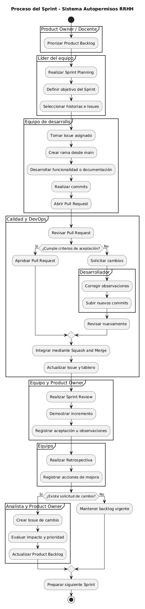
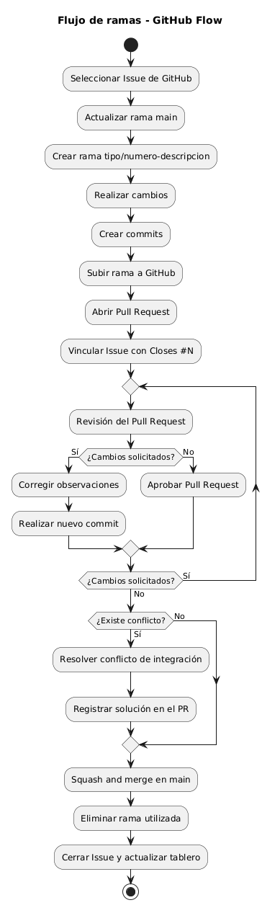

# PROCESO DEL EQUIPO

# PARTE A. METODOLOGÍA Y FLUJO

## Metodología

El equipo utilizará Scrum con iteraciones de dos semanas debido a que el proyecto necesita validaciones frecuentes y entregas incrementales.

## Flujo del Sprint

| Actividad | Entrada | Salida | Responsable |
|------------|------------|------------|------------|
| Planificar Sprint | Product Backlog | Sprint Backlog | Líder |
| Desarrollo | Historia asignada | Rama y commits | Desarrollador |
| Revisión | Pull Request | Correcciones o aprobación | Calidad |
| Integración | PR aprobado | Merge a main | DevOps |
| Revisión Sprint | Incremento funcional | Retroalimentación | Equipo |
| Retrospectiva | Métricas sprint | Acciones mejora | Líder |

## Eventos

| Evento | Cuándo | Duración | Participantes | Evidencia |
|----------|----------|----------|----------|----------|
| Sprint Planning | Inicio Sprint | 30 min | Equipo | Project |
| Seguimiento | Semanal | 15 min | Equipo | Issues |
| Sprint Review | Fin Sprint | 20 min | Equipo | Pull Requests |
| Retrospectiva | Fin Sprint | 20 min | Equipo | Acta |

## Parte B. Roles y responsabilidades

### Roles del equipo

| Rol | Integrante | Responsabilidad |
|---|---|---|
| Líder | Dennison Chalacan | Planificación y coordinación |
| Analista | Jeffrey Manobanda | Requisitos y backlog |
| Calidad y DevOps | Fernando Tipan | Revisión e integración |
| Product Owner | Docente | Priorizar y aceptar entregas |

### Matriz RACI

| Actividad | Docente | Líder | Analista | Calidad | Dev. |
|---|---|---|---|---|---|
| Priorizar backlog | A | C | R | I | I |
| Crear historias | C | I | A/R | C | C |
| Planificar sprint | C | A/R | R | C | I |
| Configurar tablero | I | A/R | C | C | I |
| Desarrollar | I | I | C | C | A/R |
| Revisar PR | I | C | C | A | R |
| Fusionar PR | I | I | I | A/R | C |
| Actualizar Project | I | A/R | C | C | R |
| Retrospectiva | I | A/R | C | C | C |
| Aceptar incremento | A/R | C | I | C | I |

R: ejecuta.
A: aprueba o rinde cuentas.
C: es consultado.
I: es informado.

Todos los integrantes participan como desarrolladores.

### Plan de rotación

| Sprint | Líder | Analista | Calidad |
|---|---|---|---|
| 1 | Dennison | Jeffrey | Fernando |
| 2 | Jeffrey | Fernando | Dennison |
| 3 | Fernando | Dennison | Jeffrey |
| 4 | Dennison | Jeffrey | Fernando |
| 5 | Jeffrey | Fernando | Dennison |
| 6 | Fernando | Dennison | Jeffrey |
| 7 | Dennison | Jeffrey | Fernando |
| 8 | Jeffrey | Fernando | Dennison |

## Parte C. Artefactos del proceso

| Artefacto | Ubicación | Responsable |
|---|---|---|
| Product Backlog | GitHub Issues y Project | Analista |
| Sprint Backlog | GitHub Project | Equipo |
| Incremento | Rama main | Equipo |
| Requisitos | docs/02-requisitos/ | Analista |
| Casos de uso | docs/03-modelado/ | Analista |
| Proceso del equipo | docs/proceso/PROCESO.md | Líder |
| Riesgos | docs/01-inicio/ | Líder |
| Retrospectivas | docs/proceso/retros/ | Líder |
| Definición de terminado | CONTRIBUTING.md | Calidad |

### Control de documentos
Los documentos se actualizan mediante Pull Requests
revisados y aprobados por otro integrante.

## Parte E. Flujo de ramas y convenciones

### Estrategia seleccionada

Se utiliza GitHub Flow porque el equipo tiene
tres integrantes y realiza entregas incrementales
cada dos semanas.

Cada actividad se registra como Issue.
Los cambios se realizan en ramas independientes,
se revisan mediante Pull Requests y se integran
a main utilizando Squash and merge.

### Comparación

| Criterio | Git Flow | GitHub Flow | Trunk Based |
|---|---|---|---|
| Complejidad | Alta | Baja | Media |
| Equipo pequeño | Regular | Excelente | Buena |
| Entrega frecuente | Media | Alta | Muy alta |
| Ramas de larga duración | Varias | No necesarias | No necesarias |
| Estrategia elegida | No | Sí | No |

### Convenciones

| Elemento | Convención | Ejemplo |
|---|---|---|
| Rama | tipo/numero-descripcion | docs/12-proceso-equipo |
| Commit | tipo: descripcion (#issue) | docs: agrega RACI (#12) |
| PR | Título descriptivo | docs: completa proceso |
| Issue | Vincular con Closes #N | Closes #12 |
| Fusión | Squash and merge | PR aprobado |
| Versión | SemVer | v0.1.0 |

### Reglas

1. Toda actividad comienza con un Issue.
2. Se crea una rama desde main.
3. Se registran los cambios mediante commits.
4. Se abre un Pull Request.
5. Otro integrante revisa y aprueba.
6. Se resuelven las observaciones.
7. Se integra mediante Squash and merge.
8. Se elimina la rama utilizada.
9. Se actualiza el tablero.

